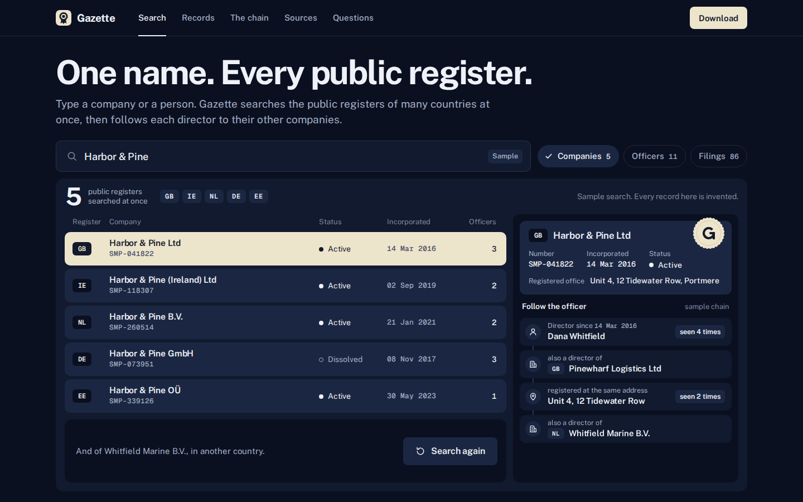
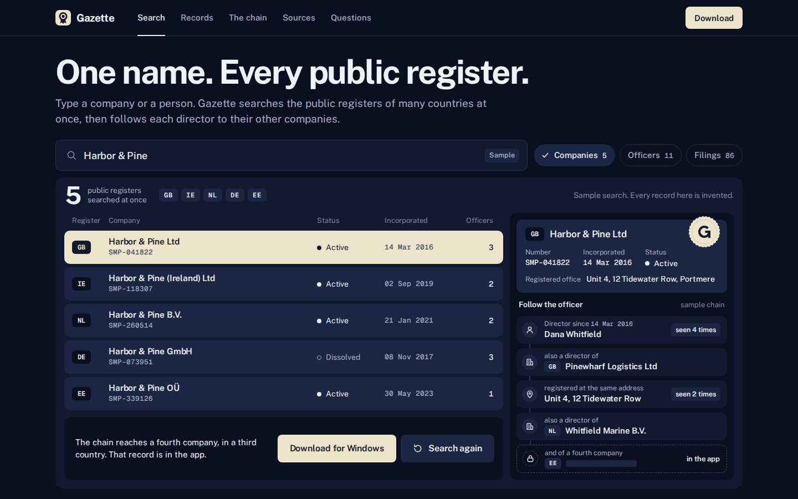

<h1 align="center">Gazette: OSINT company and officer search across public registers</h1>

<b>One name. Every public register.</b> Search the public company registers of many countries at once, then follow the officers.

OSINT · OSINT tool · company search · officer search · corporate registry · public records · due diligence · KYB · windows

> **Status: v1.1.0.** The app is out — [download Gazette for Windows](https://awesomeosint.tools/gazette/).

## Why this exists

One director, eleven companies, three of them dissolved with debts. The registers know, but each speaks its own language and keeps its own hours.

## Why it is different

Company-search sites stop at one country. Gazette asks many registers the same question and follows each director to their other companies, in one pass.

## The idea

- **One object.** A registry record card with a round embossed seal on its corner.
- **One number.** How many public registers one search covers: 5 in the sample (GB, IE, NL, DE, EE).
- **Colour.** Register navy `#0A1020` and white. Paper ivory `#EDE4CC` is the seal, the picked row and the main button, nothing else.
- **The main feature.** Follow the officer: from one company it walks the public record chain, from the director to their other companies to the addresses those are registered at, across countries, and marks every person or address that comes up again.

## The demo on the page

The search field types "Harbor & Pine" by itself. Five registers answer one after another: each lights its country code, adds one filled row to the table and raises the count to 5. The first row turns ivory and its record opens in the drawer on the right, with the seal. Then the chain is walked one hop at a time: the director Dana Whitfield, a second company she directs, the address it shares with the first, a third company in another country. The fourth company is a dashed, locked row marked "in the app", and the strip under the table offers the download next to "Search again".

The demo waits while it is off screen or the tab is hidden, and with reduced motion it shows the finished state at once. Without JavaScript the page shows the finished state and every answer in the questions block.

